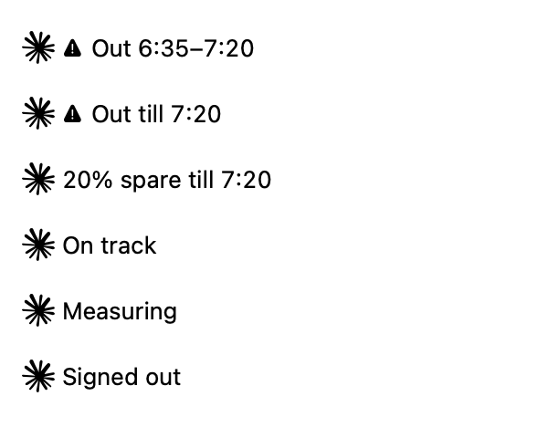

# Claude Headroom

See when your Claude quota will run out, or how much will go unused before reset, in your Mac's menu bar.

[Download Headroom](https://github.com/DivyanshGolyan/claude-headroom/releases/latest/download/Headroom.dmg) · [All releases](https://github.com/DivyanshGolyan/claude-headroom/releases)

## Install

Requires macOS 13 or later, on Apple Silicon or Intel, and [Claude Code](https://code.claude.com/docs/en/quickstart) signed in to your Claude subscription. An API key alone won't work. Xcode is needed only to build from source.

1. Download **Headroom.dmg**, open it, and drag **Headroom** into **Applications**. You can use `~/Applications` if you prefer a per-user installation. A [ZIP download](https://github.com/DivyanshGolyan/claude-headroom/releases/latest/download/Headroom.zip) is also available.
2. Open Headroom. It appears in the menu bar, with no Dock icon or app window.
3. If macOS blocks the first launch, go to **System Settings → Privacy & Security → Open Anyway**, then open it again. Releases are locally signed, not Apple-notarized. [Apple explains this approval](https://support.apple.com/en-us/102445).

Headroom reads your existing Claude Code login from Keychain. If it says **Signed out**, sign into Claude Code with `/login`, then click Headroom and choose **Refresh now**.

## Use

| Menu bar | Meaning |
|---|---|
| `Out 6:35–7:20` | At your recent pace, quota will run out before its reset. |
| `Out till 7:20` | Quota is exhausted, or predicted to be exhausted by now. |
| `20% spare till 7:20` | At least 10% is predicted to remain unused at reset. |
| `On track` | Predicted unused quota is below 10%, with no predicted outage. |
| `Measuring` | Waiting for live data or a usable observation interval. |
| `Ready` | The server reports no active five-hour window. |

Updates arrive approximately every minute. The first live response estimates pace from usage since the quota window began. Once live observations span a minute, Headroom uses measured recent consumption and refines it as history grows. Early estimates can change substantially, especially when usage is reported in whole percentage points. Forecasts assume that pace continues; they aren't guarantees. Weekly warnings identify the relevant limit and reset day.

Click or right-click for **Refresh now**, **Launch at login**, and **Quit**. Launch at login starts off. Hover for the last successful update, any error, and the scheduled retry time. During rate limits and other temporary fetch failures, usable forecasts stay visible for up to 15 minutes and dim after three. With no usable forecast, the bar shows **Rate limited · retry 6:55** or **Usage unavailable**. If a menu-bar manager hides the app, reveal it and Command-drag Headroom into the visible section.

## Privacy and limitations

Headroom sends your existing Claude OAuth token only to Anthropic's usage endpoint. It stores quota observations locally; it saves no credentials and sends no analytics. The endpoint is internal and may change. Headroom reads credentials but does not refresh them. It tracks general and Opus weekly limits; other model-specific limits are excluded.

For the calculation, quota coverage, and local data location, read [Forecasting](docs/forecasting.md). For builds, tests, and release publishing, read [Development](docs/development.md).

## Update or remove

To update, quit Headroom and replace the app with the new download. To remove it, turn off **Launch at login**, quit, and move Headroom to Trash. Its optional history file is at `~/Library/Application Support/Headroom/history.json`.

[MIT license](LICENSE). Independent project; not affiliated with Anthropic. [Logo attribution](THIRD_PARTY_NOTICES.md).
